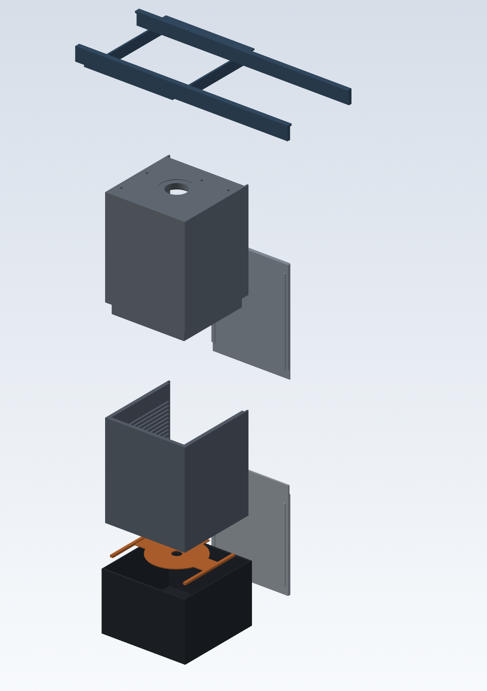
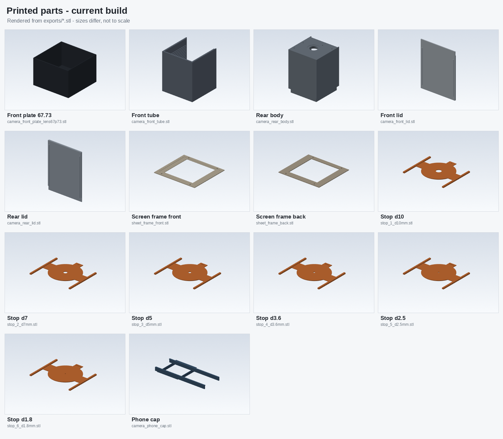

# Modular large-format box camera

A 3D-printable ~90 × 90 mm box camera built around a **Samsung S24 Ultra in its
case**, designed for a Bambu Lab A1 and PLA only. It uses interchangeable front
lens plates, drop-in aperture stops, a focusing-screen frame and a sliding phone
holder, with no glue and no metal hardware in the current build.

Full build instructions are in [ASSEMBLY.md](ASSEMBLY.md); print details are in
[PRINTSETTINGS.md](PRINTSETTINGS.md).

## Printed parts

| Part | Export | Notes |
|---|---|---|
| Front plate, 67.73 mm lens | `exports/camera_front_plate_lens67p73.stl` | Ø67.650 mm friction bore, 60 mm sliding shroud, 2 mm walls |
| Front tube | `exports/camera_front_tube.stl` | 18 focus slots (z = 25…93) plus the stop slot at z = 17 |
| Rear body | `exports/camera_rear_body.stl` | Ø22 mm aperture, foam recess, light-sealed |
| Front lid | `exports/camera_front_lid.stl` | Drop-down flange, flush fit |
| Rear lid | `exports/camera_rear_lid.stl` | Drop-down flange, flush fit |
| Screen frame (front + back) | `exports/sheet_frame_front.stl`, `exports/sheet_frame_back.stl` | Sandwich frame, alignment pins, 0.12 mm layers |
| Aperture stops (6) | `exports/stop_1_d10mm.stl` … `exports/stop_6_d1.8mm.stl` | Drop-in sliders, ≈f/5.3–f/29.4 |
| Phone cap | `exports/camera_phone_cap.stl` | Sliding C-channel, friction collar, no screws |

The older bolt-on carrier, the original 59.05 mm front plate and the lens test
parts are still in `exports/` as references, but are **not** part of the current
build shown above.

The images are generated from the STL meshes by
`python3 scripts/render_readme.py` (VTK offscreen rendering, no extra
dependencies beyond VTK and Pillow).

## Printer settings

All parts were printed on a **Bambu Lab A1** with **Elegoo black PLA**, starting
from the **0.20 mm Standard** profile with a 0.4 mm nozzle. Change only the
values below.

| Setting | Value | Notes |
|---|---|---|
| Layer height | 0.20 mm | 0.24 saves time but coarsens the 4 mm walls and 2.5 mm slot pads |
| Wall loops | 3 (1.26 mm) | Main source of stiffness; don't trade walls for infill |
| Top / bottom layers | 4 / 4 (0.8 mm) | Light-tight enough for the tube |
| Sparse infill | Gyroid 12% | Stiff in all directions, efficient |
| Wall generator | Arachne (default) | Helps with 0.9 mm webs and 1.15 mm frame halves |
| Nozzle temp | 210 °C (first layer 215 °C) | Black pigment wants a little more heat |
| Bed temp | 60 °C first layer, 55 °C after | Use the "Textured PEI Plate" preset |
| Cooling | On (default) | PLA, thin walls, no enclosure |
| Supports | None | Everything is designed flat-bottomed |
| Brim | None; 5 mm only if corners lift | The 90 × 90 bases are usually fine |
| Outer wall speed | ≤ 120 mm/s | Cleaner surface, negligible time cost |
| Seam | Aligned | Lands on a corner |

### Per-part exceptions

| Part | Change | Reason |
|---|---|---|
| Front plate (67.73 mm) | Base profile as-is; spigot up, flange on bed | With the long shroud, ~75–120 g |
| Front tube / Rear body | Base profile as-is; cavity up | 3 walls + 12% gyroid keeps tall boxes from oil-canning |
| Screen frame halves | 0.12 mm layers | 1.15 mm thickness and 0.45 mm pocket land fall badly on 0.2 mm layers |
| Aperture stops (6) | Base profile as-is | 0.9 mm web and 2.3 mm pads work fine at 0.20 mm |
| Phone cap | As modelled, z up; 4 walls, 15% gyroid | 240 mm long; shift off the bed labels, no supports, ~60 g |
| Lens test ring / alignment jig | Base profile as-is | Flat on the bed, no supports |
